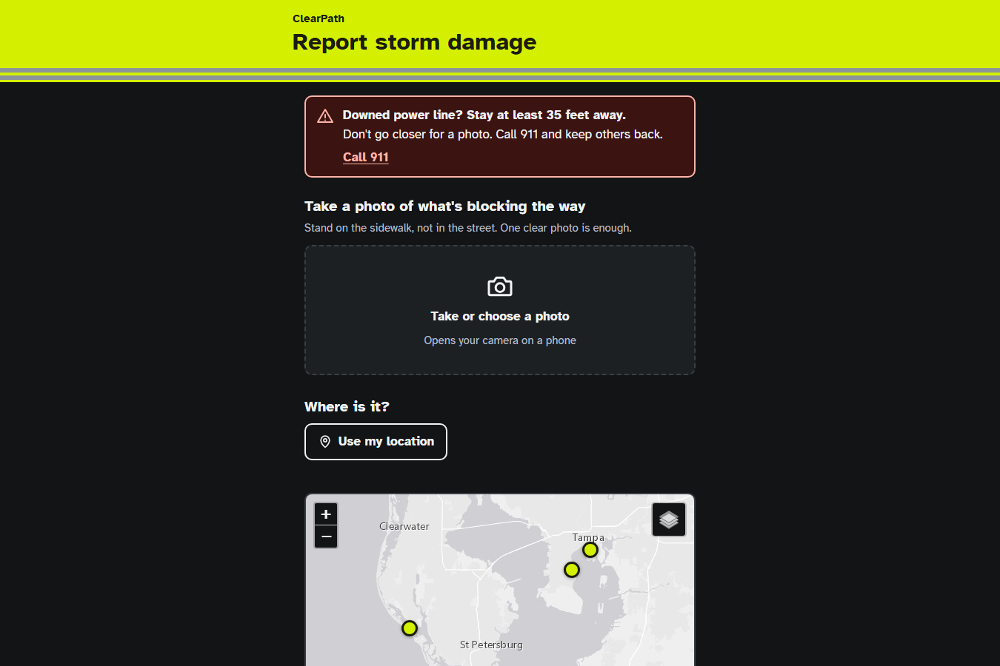
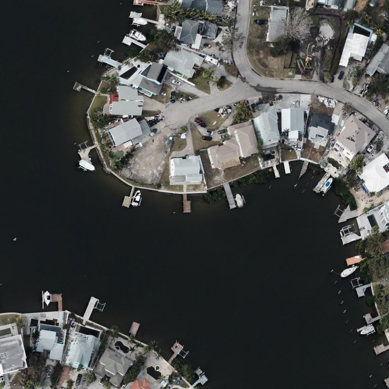

# ClearPath

**Neighborhood storm reports, from the first photo to the cleanup check.**

After a storm, a fallen tree across a driveway or water covering a curb ramp can cut off a whole block. ClearPath lets a resident photograph the problem, find nearby help, and give a reviewer enough evidence to prepare a report for the city.

Built for **HackJam 2026 | Home Turf**. [Pitch deck](docs/ClearPath%20HackJam%20Pitch.pptx) | [Three-minute demo script](docs/ClearPath%20HackJam%20Demo%20Script.txt)




## From the sidewalk to the review queue

| Resident | Reviewer |
| --- | --- |
| Upload an outdoor photo, select the spot or use phone GPS, and add a note. | Open the same report with its location, reference imagery, resident photo and suggested observations. |
| Get a report number and see nearby mapped resources. Residents can contact providers to confirm availability. | Confirm the details, export a printable report and record a follow-up photo after cleanup. |

## What the imagery shows

The Tampa Bay demo pairs archived Esri imagery with NOAA aerial surveys after Hurricanes Helene and Milton. Below is Madeira Beach on September 30, 2024, from NOAA's post-Helene flight. Streets, canals and roofs provide landmarks for placing a resident's photo.



*Image credit: NOAA National Geodetic Survey, Emergency Response Imagery.*

ClearPath compares like viewpoints to highlight visible changes. When a resident supplies a street photo against an overhead reference, the overhead view provides location context. The reviewer uses the street photo to assess the reported damage. [Imagery guide](docs/NEIGHBORHOOD_GUIDE.md)

## Under the hood

| Component | Role |
| --- | --- |
| FastAPI, Leaflet and Streamlit | Serve the resident form, neighborhood maps and reviewer dashboard. Both apps share one SQLite database. |
| OpenCV and DINOv2 | Align comparable photos and highlight areas that changed. OpenCV provides a fallback when the DINOv2 model is unavailable. |
| CLIP, SegFormer and RemoteCLIP | Optional models suggest damage categories, estimate blocked ground area and compare aerial scenes. |
| Google Gemini | Optional photo screening and draft observations. Without a key, submissions go to human review. |
| OpenStreetMap | Supplies nearby mapped resources for the response plan. |

[Model evaluations and limitations](docs/TECHNICAL.md) | [Demo walkthrough](docs/DEMO.md)

## Run locally

Install dependencies in a Python virtual environment:

```sh
python -m pip install -r requirements.txt
```

Start the two apps in separate terminals from the repository root:

```sh
python -m uvicorn api.main:app --port 8000
```

```sh
python -m streamlit run app.py --server.port 8501
```

Open the [reviewer dashboard](http://localhost:8501), choose **Before-storm photos**, and select **Add real Tampa Bay demo locations**. The first download needs internet access. Then open the [resident site](http://localhost:8000) to submit a photo.

To enable Gemini, copy [.env.example](.env.example) to a local `.env` file, set `GEMINI_API_KEY`, and restart both processes. Run the test suite with `python -m unittest -v`.
